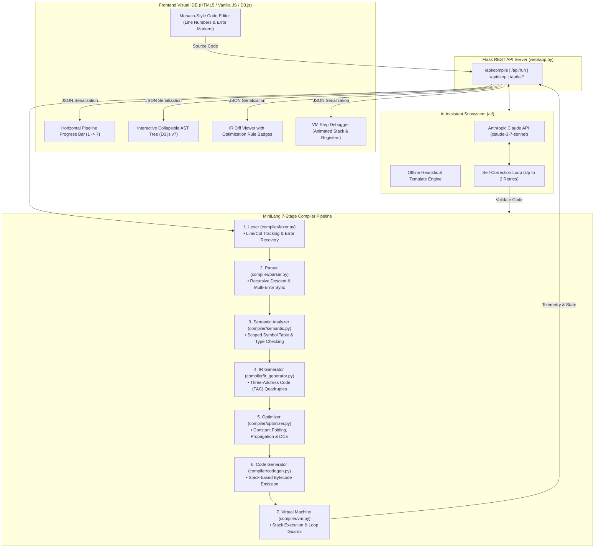

# MiniLang: AI-Assisted Compiler with a Visual Compiler Pipeline

[](https://www.python.org/downloads/)
[]()
[]()
[]()

> A complete, pedagogical compiler engineering project designed for **Compiler Construction (CS 4xx / CS 5xx)** courses. Features a custom statically typed language (**MiniLang**), an end-to-end 7-stage compiler pipeline implemented in pure standard Python without parser generators, an interactive visual Web IDE with live D3.js AST trees, TAC IR optimization diffs, and an animated step-by-step Bytecode Virtual Machine, assisted by Claude AI with full offline fallback heuristics.

---

## 1. System Architecture



---

## 2. Compiler Phase to Module Mapping

| Compiler Phase | Textbook Chapter (Aho, Lam, Sethi, Ullman) | MiniLang Module | Key Responsibilities & Data Structures |
| :--- | :--- | :--- | :--- |
| **1. Lexical Analysis** | Dragon Book Ch. 3 | `compiler/tokens.py`<br/>`compiler/lexer.py` | Scans raw characters, strips comments (`//`), handles string escapes, produces `Token` objects with line & column. Recovers from unrecognized glyphs. |
| **2. Syntax Analysis** | Dragon Book Ch. 4 | `compiler/ast_nodes.py`<br/>`compiler/parser.py` | Top-down recursive descent parser with precedence climbing. Produces `ASTNode` tree with `to_dict()` for D3.js. Panic-mode multi-error recovery. |
| **3. Semantic Analysis** | Dragon Book Ch. 6 | `compiler/semantic.py` | Constructs hierarchical `SymbolTable` (Global, Function, Block). Enforces static typing, variable initialization, redeclaration limits, and definite returns. |
| **4. Intermediate Code Gen** | Dragon Book Ch. 6 & 8 | `compiler/ir.py`<br/>`compiler/ir_generator.py` | Linearizes hierarchical AST into Three-Address Code (`TACInstruction`) with explicit temporaries (`t0, t1, ...`) and labels (`L0, L1, ...`). |
| **5. Machine-Independent Optimization** | Dragon Book Ch. 9 | `compiler/optimizer.py` | Multi-pass fixed-point optimizer implementing Constant Folding, Constant Propagation, and Dead Code Elimination with precise rule firing logs. |
| **6. Code Generation** | Dragon Book Ch. 8 | `compiler/codegen.py` | Translates TAC quadruples into stack-based virtual bytecode (`BytecodeInstruction`). Resolves symbolic jump targets to absolute instruction pointers. |
| **7. Runtime Virtual Machine** | Dragon Book Ch. 7 | `compiler/vm.py` | Abstract stack computer runtime with operand stack, activation records (`CallFrame`), environment maps, and infinite loop instruction guards. |
| **AI Assistant & Fallbacks** | Modern AI Tooling | `ai/assistant.py`<br/>`ai/templates.py` | Claude 3.7 API integration with self-correction compiler validation loop, plus 100% offline rule-based heuristic fallback engine. |

---

## 3. The MiniLang Custom Language

MiniLang is an imperative, statically typed language featuring C/Rust-style syntax.

### Types
- `int` (64-bit integer)
- `float` (Double-precision IEEE 754 float)
- `bool` (`true` or `false`)
- `string` (Double-quoted string with escape sequences)
- `void` (Function return type for procedures)

### Language Features
1. **Variable Declarations**:
   ```minilang
   let x: int = 42;       // Explicit type annotation
   let y = 3.14;          // Inferred type (float)
   let z: string;         // Default-initialized to ""
   ```
2. **Control Flow**:
   ```minilang
   if (x > 0) {
       print("Positive");
   } else if (x == 0) {
       print("Zero");
   } else {
       print("Negative");
   }

   while (count < 10) {
       count = count + 1;
   }

   for (let i = 0; i < 5; i = i + 1) {
       print(i);
   }
   ```
3. **Functions & Recursion**:
   ```minilang
   fn factorial(n: int) -> int {
       if (n <= 1) {
           return 1;
       }
       return n * factorial(n - 1);
   }
   ```
4. **Standard Library**:
   ```minilang
   print("Values:", a, b, c); // Variadic print statement
   ```

Formal EBNF Grammar specification is documented in [`docs/grammar.md`](docs/grammar.md).

---

## 4. Setup and Installation

### Prerequisites
- Python 3.10+ (Python 3.11 or 3.12 recommended)
- Git (optional)

### 1. Clone or Navigate to the Repository
```bash
cd minilang-compiler
```

### 2. Create and Activate a Virtual Environment
- **On Windows (PowerShell)**:
  ```powershell
  python -m venv venv
  .\venv\Scripts\Activate.ps1
  ```
- **On Linux / macOS**:
  ```bash
  python3 -m venv venv
  source venv/bin/activate
  ```

### 3. Install Dependencies
```bash
pip install -r requirements.txt
```

### 4. Configure Environment Variables (Optional)
Copy `.env.example` to `.env`:
```bash
cp .env.example .env
```
Add your Anthropic API Key for online Claude AI features:
```env
ANTHROPIC_API_KEY=sk-ant-api03-...
```
> **Note**: The compiler and visual pipeline are **100% operational offline**. If no API key is provided, the system seamlessly uses its built-in rule-based heuristic explanation engine!

---

## 5. Running the Project

### A. Launch the Visual Web IDE
```bash
python run.py
```
Open your browser and navigate to:
```
http://localhost:5000/
```

### B. Command-Line (CLI) Compiler Mode
Compile and execute any MiniLang source file directly from your terminal:
```bash
# Example 1: Hello World and arithmetic
python run.py --cli examples/01_hello.mlang

# Example 2: Recursive & iterative factorial
python run.py --cli examples/02_factorial.mlang

# Example 3: Fibonacci sequence
python run.py --cli examples/03_fibonacci.mlang

# Example 4: Prime number check
python run.py --cli examples/04_prime_check.mlang

# Example 5: Nested loops and matrix multiplication
python run.py --cli examples/05_nested_loops.mlang
```

### C. Run the Pytest Test Suite
Execute all 49 unit and integration tests:
```bash
pytest -v
```

---

## 6. How to Import the Project into IDEs

### Importing into Visual Studio Code (VS Code)
1. Launch VS Code.
2. Click **File -> Open Folder...** (`Ctrl + K, Ctrl + O`).
3. Select `minilang-compiler`.
4. Open the command palette (`Ctrl + Shift + P`) and select **Python: Select Interpreter**.
5. Choose the interpreter inside your virtual environment (`.\venv\Scripts\python.exe` or global Python 3.11).
6. To run tests in VS Code, open the **Testing** tab on the left sidebar and click **Configure Python Tests** -> **pytest**.
7. Press `F5` or run `python run.py` in the integrated terminal (`Ctrl + ~`).

### Importing into PyCharm
1. Open PyCharm and click **Open**.
2. Select the `minilang-compiler` root folder.
3. Go to **Settings / Preferences -> Project: minilang-compiler -> Python Interpreter**.
4. Click **Add Interpreter** -> **Existing Environment** and browse to `venv/Scripts/python.exe`.
5. Right-click on `run.py` and select **Run 'run'**.
6. Right-click on the `tests` directory and select **Run 'pytest in tests'**.

---

## 7. Visual IDE Walkthrough & UI Layout

```
+----------------------------------------------------------------------------------------------------+
|  [#] MiniLang Compiler  [Visual Pipeline 2.0]     [Examples v] [Compile] [Run] [AI Prompt] [Hints]  |
+----------------------------------------------------------------------------------------------------+
|  [v 1. Lexer] -> [v 2. Parser] -> [v 3. Semantics] -> [v 4. IR] -> [v 5. Opt] -> [v 6. Bytecode]   |
+----------------------------------------------------------------------------------------------------+
|  LEFT PANE: Source Code Editor              |  RIGHT PANE: Visual Telemetry Tabs                   |
|                                             |  [Tokens] [AST] [Symbols] [IR Diff] [Bytecode] [VM]  |
|  1 | fn factorial(n: int) -> int {          |  --------------------------------------------------  |
|  2 |     if (n <= 1) { return 1; }          |  [Interactive D3.js Collapsible AST Tree]            |
|  3 |     return n * factorial(n - 1);       |       (Program)                                      |
|  4 | }                                      |         /     \                                      |
|  5 | let ans = factorial(5);                |     (FnDecl)  (VarDecl: ans)                         |
|  6 | print(ans);                            |       /           \                                  |
|                                             |    (Block)      (Call: factorial)                    |
|  -----------------------------------------  |  --------------------------------------------------  |
|  [!] Error Banner: Line 3 Column 12         |  [VM Debugger: Stack [ 120 ], IP: 0014, Globals ]    |
+----------------------------------------------------------------------------------------------------+
```

### Features Overview
- **Tokens Tab**: Interactive grid of tokens displaying lexical classification, raw lexemes, line numbers, and column offsets.
- **AST Tab**: D3.js v7 hierarchical tree diagram. Click any node to collapse or expand subtrees, hover to view evaluated static types, and use the mouse wheel to zoom/pan.
- **Symbol Table Tab**: Hierarchical scoped symbol table (Global Scope, Function scopes, Block scopes) displaying variable types, parameter counts, and lexical levels.
- **IR & Diff Tab**: Side-by-side comparison of Raw TAC IR vs Optimized TAC IR with changed instructions highlighted and badges showing which optimization rule fired (Constant Folding, Constant Propagation, Dead Code Elimination).
- **Bytecode Tab**: Disassembled stack instruction listing with resolved instruction pointers (IP).
- **VM Execution Debugger**: Complete execution stepper featuring:
  - `[Step Next]`: Executes exactly one bytecode instruction.
  - `[Auto Step]`: Continuously steps with adjustable animation delays.
  - `[Reset VM]`: Restores IP to 0 and clears stack/registers.
  - Animated vertical stack rendering and live call frame activations.
- **AI Assistant**: Plain-English error diagnostics with line context, stage walkthroughs, and natural language code generation backed by a compiler validation loop.

---

## 8. Compiler Construction Viva Questions & Answers

### Q1: What is the difference between Top-Down (LL) and Bottom-Up (LR) parsing? Where does MiniLang's parser fit?
**Answer**:
- **Top-Down Parsing (LL)** starts with the start symbol at the root of the parse tree and attempts to rewrite non-terminals down to the input tokens. It reads tokens from Left-to-right and produces a Leftmost derivation.
- **Bottom-Up Parsing (LR)** starts with the terminal tokens and repeatedly performs "shift" (pushing tokens onto a parse stack) and "reduce" (replacing a handle with a non-terminal) actions until reaching the start symbol, producing a Rightmost derivation in reverse.
- **MiniLang's Parser** is an **LL(1) Top-Down Recursive Descent Parser** with Pratt-style precedence climbing for expressions. Each grammar non-terminal corresponds to a Python method (e.g., `_parse_if_stmt()`, `_parse_expression()`). It uses 1 lookahead token (`_peek()`) to choose production branches deterministically without backtracking.

### Q2: What is the Chomsky Hierarchy, and which levels describe MiniLang's tokens and syntax?
**Answer**:
The Chomsky Hierarchy classifies formal grammars into four levels:
1. **Type-3 (Regular Grammars)**: Parsed by Finite State Automata (FSA/DFA). Generates regular languages (no nested counting). **MiniLang's Lexer** operates at Type-3 to recognize tokens (keywords, numbers, strings).
2. **Type-2 (Context-Free Grammars)**: Parsed by Pushdown Automata (with a stack). Capable of matching arbitrary nesting (parentheses, nested blocks, expressions). **MiniLang's Parser** operates at Type-2, defined formally in EBNF.
3. **Type-1 (Context-Sensitive Grammars)**: Production rules depend on surrounding context.
4. **Type-0 (Unrestricted / Turing Equivalent)**: General computability.

### Q3: What is Panic-Mode Error Recovery, and how is it implemented in this compiler?
**Answer**:
Panic-mode error recovery is a synchronization strategy where, upon detecting a syntax error, the parser records the diagnostic and discards incoming tokens until a designated **synchronizing token** is encountered. In MiniLang's `_synchronize()` method, tokens are skipped until reaching either a statement terminator (`;`, `}`) or a statement-initiating keyword (`let`, `fn`, `if`, `while`, `for`, `return`, `print`). This allows the parser to recover and detect **multiple independent syntax errors** in a single compilation pass rather than failing at the very first error.

### Q4: How does a Scoped Symbol Table manage variable shadowing and lexical scope?
**Answer**:
A scoped symbol table is organized as a tree (or stack) of hash tables representing lexical environments. Each `SymbolTable` maintains a dictionary of declared symbols in its local scope and a pointer to its `parent` scope.
- **Lookup**: When resolving an identifier, the compiler queries the current scope. If not found, it recursively queries the `parent` scope up to the global scope.
- **Shadowing**: When a variable is declared in an inner block with the same name as an outer variable, it is inserted into the inner table. Lookups in the inner scope resolve to the local variable first, safely shadowing the outer variable without destroying it.
- **Redeclaration**: If a declaration is attempted and the symbol already exists in `current_scope.symbols`, a duplicate declaration error is raised.

### Q5: What is the distinction between Type Checking and Type Inference?
**Answer**:
- **Type Checking** verifies that expressions conform to explicit language typing constraints (e.g., checking that `let x: int = 5.5;` is illegal because `float` cannot be assigned to `int`).
- **Type Inference** automatically deduces the type of an unannotated variable from its initializing expression at compile time (e.g., in `let x = 5 + 3;`, the compiler evaluates `5 + 3` as `int` and statically assigns `inferred_type = 'int'` to `x`).

### Q6: What is Three-Address Code (TAC), and why is it preferred over raw AST for optimization?
**Answer**:
Three-Address Code is a linearized intermediate representation where every instruction has at most one operator and at most three address operands: `result = arg1 op arg2`.
Raw ASTs are deeply nested trees with non-linear control flow and implicit evaluation orders. TAC simplifies analysis because:
1. Complex nested expressions are flattened into explicit linear sequences using temporary variables (`t0, t1, ...`).
2. Control flow is converted into explicit conditional and unconditional jumps to labels (`L0, L1, ...`).
3. Standard data-flow equations (liveness, reaching definitions) and compiler optimizations (constant folding, dead code elimination) are significantly easier to implement over linear instruction arrays.

### Q7: What is the difference between Constant Folding and Constant Propagation?
**Answer**:
- **Constant Folding** evaluates operations on compile-time literals into a single constant at compile time (e.g., transforming `t0 = 15 + 4` into `t0 = 19`).
- **Constant Propagation** replaces occurrences of a variable with its assigned constant value across instructions within a basic block (e.g., if `x = 10`, replacing `t1 = x + 2` with `t1 = 10 + 2`).
- When used together iteratively, Constant Propagation followed by Constant Folding simplifies entire computation chains into compile-time constants.

### Q8: What is Dead Code Elimination (DCE), and what safety preconditions are required?
**Answer**:
Dead Code Elimination removes instructions whose results are never subsequently read by any reachable instruction, as well as code that can never be reached during execution (e.g., statements following an unconditional `return` or `goto`).
**Preconditions**:
- The instruction must not have observable **side effects** (e.g., I/O print operations or function calls that may modify memory cannot be eliminated even if their return values are unused).
- In MiniLang, unused temporary variables (`tX`) generated during expression linearization are safely culled if they never appear as an argument in any subsequent instruction.

### Q9: Compare Stack-Based Virtual Machines with Register-Based Virtual Machines.
**Answer**:
- **Stack-Based VM (MiniLang, JVM, Python bytecode)**:
  - Instructions implicitly operate on an operand stack (e.g., `PUSH 5`, `PUSH 3`, `BINARY_ADD`, `STORE x`).
  - Bytecode is compact and very simple to generate from AST/TAC without needing register allocation algorithms (like graph coloring).
  - Requires more instructions per high-level statement due to push/pop overhead.
- **Register-Based VM (LuaJIT, Dalvik)**:
  - Instructions explicitly specify source and destination virtual registers (e.g., `ADD r0, r1, r2`).
  - Produces fewer total instructions and avoids stack thrashing.
  - Compiler requires complex register allocation algorithms to map unlimited variables to limited registers.

### Q10: How does the Call Stack / Activation Record structure support recursion in MiniLang's Virtual Machine?
**Answer**:
When a function is invoked via `CALL_FUNC`:
1. The VM pops the actual arguments from the operand stack and creates a new `CallFrame` (activation record).
2. The `CallFrame` stores the `func_name`, the `return_ip` (the address to resume after returning), and a dictionary of `locals` binding parameter names to argument values.
3. The frame is pushed onto `self.call_stack`. Because each invocation gets its own distinct `CallFrame`, recursive calls operate on independent local variables and retain separate return pointers.
4. When `RETURN_VAL` executes, the top `CallFrame` is popped, restoring the caller's local scope, and execution jumps back to `frame.return_ip`.

---

## 9. Project Directory Structure

```
minilang-compiler/
├── docs/
│   └── grammar.md                # Formal EBNF grammar specification
├── examples/
│   ├── 01_hello.mlang            # Hello World & basic arithmetic
│   ├── 02_factorial.mlang        # Recursive and iterative factorial
│   ├── 03_fibonacci.mlang        # Fibonacci sequence calculation
│   ├── 04_prime_check.mlang      # Prime number checker with modulo & logic
│   └── 05_nested_loops.mlang     # Nested for/while loops and patterns
├── compiler/
│   ├── __init__.py
│   ├── tokens.py                 # TokenType enum & Token dataclass
│   ├── lexer.py                  # Scanner with line/col tracking & recovery
│   ├── ast_nodes.py              # Strongly typed AST with D3 JSON serializer
│   ├── parser.py                 # Recursive descent with multi-error sync
│   ├── semantic.py               # Scoped symbol table & static type checker
│   ├── ir.py                     # TAC Instruction model & OpCode definitions
│   ├── ir_generator.py           # AST to Three-Address Code generator
│   ├── optimizer.py              # Constant folding, propagation & DCE
│   ├── codegen.py                # Stack-based Bytecode emission & label resolution
│   ├── vm.py                     # Virtual machine with step debugger & loop guards
│   └── pipeline.py               # 7-stage master compiler orchestrator
├── ai/
│   ├── __init__.py
│   ├── assistant.py              # Anthropic Claude API client & self-correction loop
│   └── templates.py              # 100% offline heuristic & template fallback engine
├── web/
│   ├── app.py                    # Flask server with REST API endpoints
│   ├── static/
│   │   ├── css/
│   │   │   └── style.css         # Dark IDE theme & visual pipeline styling
│   │   └── js/
│   │       ├── api.js            # API fetch client
│   │       ├── ast_viewer.js     # D3.js interactive collapsible AST tree
│   │       ├── ir_diff.js        # IR diff visualizer with rule badges
│   │       ├── vm_visualizer.js  # Animated VM debugger & stack visualizer
│   │       └── app.js            # UI coordinator & editor line numbers
│   └── templates/
│       └── index.html            # Single-page web IDE application
├── tests/
│   ├── __init__.py
│   ├── test_lexer.py             # Lexer tokenization & recovery tests
│   ├── test_parser.py            # Precedence, statements & multi-error tests
│   ├── test_semantic.py          # Scoping, types, undefined vars & return tests
│   ├── test_ir_opt.py            # TAC IR generation & optimization rule tests
│   ├── test_vm.py                # VM execution, recursion, division-by-zero & limits
│   └── test_integration.py      # End-to-end examples & Flask API tests
├── requirements.txt
├── run.py                        # Unified entrypoint (Web server & CLI)
├── .env.example                  # Environment variable template
└── README.md                     # Comprehensive project documentation & viva Q&As
```

---

## 10. License

This project is licensed under the MIT License - see the LICENSE file for details. Built for educational excellence in Compiler Construction.
